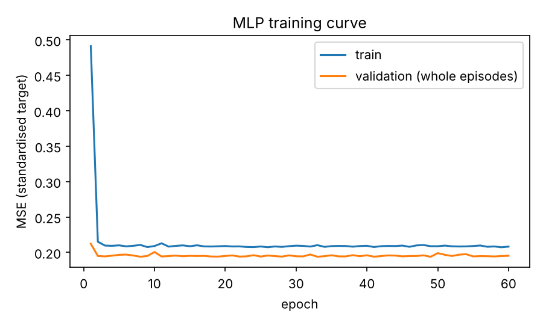

# mlp_dynamics (Planner Days 37-44)

An MLP (`src/nn/mlp.py`, plain PyTorch) learns the one-step plant dynamics and is
compared with Linear Regression and Random Forest on the same episodes.

```bash
make mlp-study     # tune (Optuna), train, compare, log to W&B (offline by default)
make harden        # Day 40: 100 consecutive episodes + same-seed reproducibility
```

| Day | What | Where |
|---|---|---|
| 37 | `nn.Module` + full training loop (Adam, early stopping, seeded) | `src/nn/mlp.py`, `tests/test_mlp.py` |
| 38 | Optuna search: episode-grouped CV, pruner, fixed budget, test set untouched | `tuning.py` |
| 39 | W&B that cannot stop a run (`online` without a login falls back to `offline`) | `wandb_utils.py` |
| 40 | Hardening: 100 episodes, finite checks, reproducibility | `hardening.py` |
| 41 | Bug fixes | `../../ISSUES.md` |
| 43 | MLP on thermal data through the existing `make_model` | `run_mlp_study.py` |
| 44 | Comparison table (R2, MAE, MSE, skill scores, safety) | `outputs/mlp_study/comparison.md` |

## Result (seed 42, 12 train / 3 test episodes, AR(1) load, rho 0.9, std 30 W)

On the best recipe (`full` features, `physics_residual` target) all three models are
indistinguishable and sit on the theoretical noise floor:

| model | MSE | R2_delta | Skill vs physics |
|---|---|---|---|
| noise floor (no model can beat it) | 0.000684 | | |
| Linear | 0.000697 | 0.9538 | 0.828 |
| Random Forest (tuned) | 0.000713 | 0.9527 | 0.824 |
| MLP (tuned, 5 seeds) | 0.000706 +/- 0.000013 | 0.9531 +/- 0.0009 | 0.825 |
| physics with d = 0 (no learning) | 0.00405 | 0.7316 | 0 |

Reading it honestly:

* **The MLP adds nothing over Linear regression on this plant.** The plant is linear;
  a linear model with the right features already reaches the noise floor. The MLP
  becomes interesting only if the plant gets a real nonlinearity (ISSUES.md I-7).
* **The recipe matters, the model does not.** On raw features and the raw target
  (`naive`) the best model is Linear (R2_delta 0.733); the Random Forest is clearly
  worse (0.493) and **misses 100 % of the true violations on the stress set**
  (it cannot extrapolate), which is the motivation for the CBF layer.
* **R2 on `T_next` is useless here**: persistence scores 0.9998. Look at `R2_delta`
  and the skill columns.
* Not a fair claim: Optuna tuned the MLP and a grid tuned the RF, but only 3 test
  episodes exist, so differences in the third digit are noise.




## Plant v2 result (`--plant v2`, same seed, 12 train / 3 test episodes)

| model (best recipe) | MSE | R2_delta | Skill vs physics |
|---|---|---|---|
| noise floor | 0.000653 | | |
| Linear | 0.000665 | 0.9781 | 0.837 |
| Random Forest (tuned) | 0.000683 | 0.9775 | 0.833 |
| MLP (tuned, 5 seeds) | 0.000675 +/- 0.000004 | 0.9777 +/- 0.0001 | 0.834 |
| physics with d = 0 | 0.00408 | 0.8655 | 0 |

Honest reading:

* **Making the plant nonlinear did not make the MLP win.** With beta = 0.005 and
  30 W load noise, the one-step nonlinear signal is smaller than the noise, so Linear
  with good features still sits on the noise floor. A one-step R2 cannot show the
  value of a nonlinear model here; a multi-step rollout error or a near-edge subset can.
  Do not claim "MLP beats linear" for this plant.
* Naive recipe: the RF is again the worst (R2_delta 0.597).
* **GATE M2 (block-mean rule) = FAIL on both plants.** v2 train blocks
  0.2357, 0.2011, 0.2014, 0.2006 (flat after block 1: the loss hits its floor by epoch ~6);
  legacy 0.2671, 0.2091, 0.2099, 0.2090. Validation blocks decrease on legacy, not on v2.
  The model is converged, not broken. The rule needs a convergence-based wording
  (ISSUES.md I-9); not changed after seeing the result without your decision.
